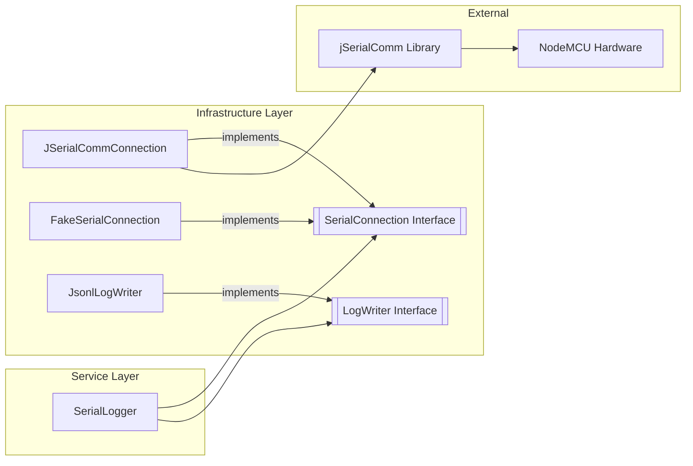

# Requirements

### Overview & Goals
The goal is to enable the `robolab-sidekick` tool to connect to real hardware (NodeMCU) via a serial port and capture its logs. Currently, the project only has a fake serial implementation for unit testing.

### Scope
- **In Scope**:
    - Adding `jSerialComm` dependency.
    - Implementing the `SerialConnection` interface using `jSerialComm`.
    - Providing a port discovery utility.
    - Adding a manual JUnit test for verification with real hardware.
    - Updating default configuration (baud rate) to match common NodeMCU settings.
- **Out of Scope**:
    - Automated hardware tests in CI.
    - Reconnection logic (handled by `SerialLogger` or deferred to v2).
    - Writing to the serial port (v1 is read-only for logs).

### User Stories
- As a robotics developer, I want to connect my NodeMCU to the tool so that its serial logs are automatically captured, timestamped, and saved to JSONL files.
- As a developer, I want to easily see which serial ports are available so I can configure the tool correctly.

# Technical Design

### Current Implementation
The project defines a [SerialConnection.kt](air-file://opd1ddl9berbk7q4m5el/home/grasshead/docs/gitrepos/ai-dev/robolab-sidekick/src/main/kotlin/com/petrukhnov/robolab/sidekick/infrastructure/SerialConnection.kt?type=file&root=%252F) interface and uses it in [SerialLogger.kt](air-file://opd1ddl9berbk7q4m5el/home/grasshead/docs/gitrepos/ai-dev/robolab-sidekick/src/main/kotlin/com/petrukhnov/robolab/sidekick/service/SerialLogger.kt?type=file&root=%252F). Tests currently rely on [FakeSerialConnection.kt](air-file://opd1ddl9berbk7q4m5el/home/grasshead/docs/gitrepos/ai-dev/robolab-sidekick/src/main/kotlin/com/petrukhnov/robolab/sidekick/infrastructure/fake/FakeSerialConnection.kt?type=file&root=%252F).

### Proposed Changes
- **Dependency**: Add `com.fazecast:jSerialComm:2.11.0`. This library is chosen for its ease of use on JVM and because it doesn't require separate native library installation.
- **Infrastructure Layer**:
    - New class `JSerialCommConnection` implementing `SerialConnection`.
    - Use `SerialPort.getInputStream()` wrapped in a `BufferedReader` for line-by-line reading.
    - Set read timeouts to ensure the reading thread remains interruptible.
- **Port Discovery**: A static `listAvailablePorts(): List<String>` method to facilitate setup.
- **Configuration**: Update [AppConfig.kt](air-file://opd1ddl9berbk7q4m5el/home/grasshead/docs/gitrepos/ai-dev/robolab-sidekick/src/main/kotlin/com/petrukhnov/robolab/sidekick/config/AppConfig.kt?type=file&root=%252F) default baud rate from 115000 to 115200.

### Architecture Diagram

### Risks
- **Platform Specifics**: Serial port naming differs between Windows (`COM1`) and Linux/macOS (`/dev/ttyUSB0`). The manual test will provide a list of available ports to help.
- **Blocking Reads**: If `readLine()` blocks indefinitely, the logger might not stop promptly. We will use `SerialPort` timeouts to mitigate this.

# Testing

### Validation Approach
Since automated hardware testing is not possible in CI, we will provide a manual JUnit test.

### Key Scenarios
1. **Port Discovery**: Run the utility to ensure it detects the connected NodeMCU.
2. **Connection**: Verify the tool can open the port and detect if it's connected.
3. **Log Capture**: Verify that logs sent by the NodeMCU appear in the test output with correct content.
4. **Resilience**: Ensure that disconnecting the device during the test is handled gracefully (mapping to `SerialException`).

### Manual Test Details
The `JSerialCommManualTest` will be marked with `@Disabled` to prevent CI failures. It will:
- List all available ports.
- Use a port name provided via `-Dserial.port` system property (or default to the first available).
- Run for a fixed duration (e.g., 10 seconds) and print all received lines.

# Delivery Steps

###   Step 1: Implement JSerialCommConnection and update configuration
The project has the necessary library to communicate with serial ports and a production-ready implementation of the `SerialConnection` interface.

- Add `com.fazecast:jSerialComm:2.11.0` to [build.gradle.kts](air-file://opd1ddl9berbk7q4m5el/home/grasshead/docs/gitrepos/ai-dev/robolab-sidekick/build.gradle.kts?type=file&root=%252F).
- Update [AppConfig.kt](air-file://opd1ddl9berbk7q4m5el/home/grasshead/docs/gitrepos/ai-dev/robolab-sidekick/src/main/kotlin/com/petrukhnov/robolab/sidekick/config/AppConfig.kt?type=file&root=%252F) to use 115200 as the default baud rate.
- Create `JSerialCommConnection.kt` in `src/main/kotlin/com/petrukhnov/robolab/sidekick/infrastructure/serial/`.
- Implement `connect()`, `disconnect()`, `isConnected()`, and `readLine()` using `jSerialComm`.
- Add a `listAvailablePorts()` companion method to help with port discovery.
- Map `jSerialComm` errors to project-specific exceptions (`SerialException`, `PortNotFoundException`, etc.).

###   Step 2: Add manual verification test for real hardware
A manual JUnit test is available to verify that logs are correctly received from a physical NodeMCU.

- Create `JSerialCommManualTest.kt` in `src/test/kotlin/com/petrukhnov/robolab/sidekick/infrastructure/serial/`.
- Add a test case that lists available ports to the console for user convenience.
- Implement a `@Disabled` test that connects to a specified port and prints received lines to stdout for 10 seconds.
- Verify that the received logs are correctly timestamped and sequenced when processed by `SerialLogger` (in a separate manual verification step if needed).